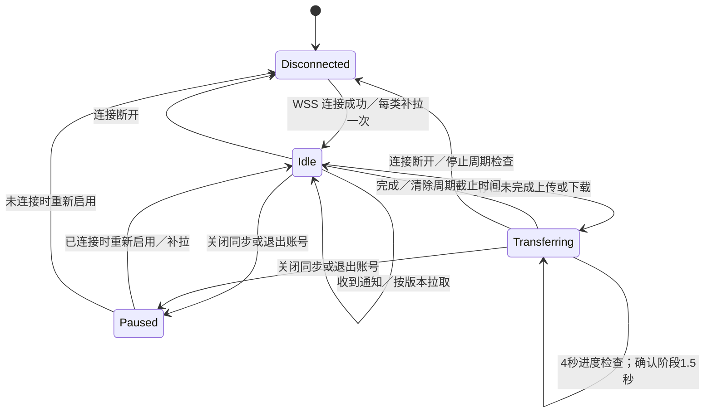

# FlickDock 1.8.27：云端纯推送自动同步

## 模块与边界

| 模块 | 职责 |
| --- | --- |
| `cloud_events.py` | 每个客户端的一条自动同步 WSS 通道、连接超时、带抖动的指数重连；没有空闲心跳或状态轮询 |
| `sync_scheduler.py` | 两类同步共用一个 deadline 队列和一个 Qt 单次定时器；空闲、断线时没有周期 deadline |
| `shelf_sync.py` | 通知后读取 `/v1/sync/changes`，按版本下载和校验；保留 tombstone、重命名和下载竞态保护 |
| `clipboard_sync.py` | 短文字通知直达；图片/文件先读取 `/v1/clipboard`，再按 ID 下载、校验并写入系统剪贴板 |
| `cloud/src/index.ts` 的 `AccountEvents` | 同账号广播、Hibernation 连接附件、连接生命周期处理 |
| `cloud/src/clipboard.ts` | 现有最新一份剪贴板、版本、内容和接收回执接口；协议不变 |
| `cloud/wrangler.jsonc` | 现有 `EVENTS`/`AccountEvents` SQLite Durable Object 绑定和 exports 配置 |

`lan_transfer.py`、`wan_transfer.py`、`lan_account.py`、`webrtc_stream.py` 与 `cloud/src/wan.ts` 的手动互传协议不改。自动同步不使用局域网/P2P。

同账号设备始终以 `EVENTS.idFromName(owner.id)` 连接同一个固定 DO；其他账号使用不同实例。不能让所有用户共享一个未隔离的 `shared-clipboard` 实例。

## 服务端 Hibernation

`AccountEvents.fetch('/connect')` 调用 `this.ctx.acceptWebSocket(server)`，并通过 `serializeAttachment()` 保存现有 `device`（设备 ID）及会话到期时间。广播使用 `this.ctx.getWebSockets()`、`deserializeAttachment()` 和 `readyState === WebSocket.OPEN`，排除发送设备。

实现了 `webSocketMessage`、`webSocketClose`、`webSocketError`。连接为服务端通知用途，提交仍经过原有认证与版本校验 HTTP 接口；未引入新的客户端业务帧。没有 `server.accept()`、应用层心跳或保持 DO 唤醒的 JavaScript 定时器。现有 `progressSent` 仅是可丢弃的限流缓存，不保存连接。

保留 `clipboard_inline`、`clipboard`、`content`、`progress`、`clipboard_delivery` 的格式。短文字可携带有界内容；图片、文件只发送版本通知，正文保留在 R2，通过原有 HTTP 内容接口获取。DO storage 中现有的 `clipboard-head` 保留最新版本，重连读取沿用该接口。

没有新增或重命名 DO 类、命名空间、D1 表，因此不添加会迁移或重置已有对象的 migration。现有 JSONC 配置与 SQLite exports 声明继续有效；原有 D1 migrations 必须保留。`cloud/test/hibernation-entry.ts` 只供本机测试，不是生产入口。

## 共用调度接口

```python
scheduler = SyncScheduler(app, connected=False)
shelf = ShelfSync(base, account, adapter, scheduler=scheduler)
clipboard = ClipboardSync(account, events, base, scheduler=scheduler)
# ClipboardSync 将同一 scheduler 绑定到 events.socket，只绑定一次。
```

两类同步分别注册 `shelf`、`clipboard`。`register(kind, callback)` 返回注册句柄：

- `configure(enabled=..., transferring=..., finishing=...)` 更新状态；只有在线且有未完成传输时，周期为 4000 ms，最后确认/校验阶段为 1500 ms。
- `request()` 将通知合并为一次异步检查，不按通知数量重复请求。
- `defer(delay_ms)` 保留服务器要求的单次退避，避免通知绕过限流；不是全局兜底周期。
- `close()` 注销任务，清除截止时间；账号变化会暂停并重建该账号的任务状态。

`sync_decision()` 是共用纯策略函数，输出状态、下一次进度检查延迟或 `None`，及连接恢复时是否立即触发。普通在线、断线均输出 `None`。断线期间暂存通知唤醒，不发全局版本检查；恢复时每个启用的同步注册合并为一次补拉。分页或缺失文件仍可能需要多次 HTTP 请求，这是一次逻辑补齐流程，而非重复全量同步。



短文字在 `clipboard_inline` 分支直接解码、校验并写入，不需要先 GET 版本或下载正文。已收到但暂时不能写入系统剪贴板的内容仍按本机写入重试处理，不把未确认写入报成成功。未完成传输的进度检查只请求版本/元数据，不重复启动同一个正文下载。

## 重连与删除的定时器

`CloudEvents._disconnected()` 使用约 1、2、4、8、16、30 秒的指数退避，带 ±20% 抖动，上限 30 秒。连接握手保留一次性 12 秒超时。连接成功会清除退避和握手超时，由共用调度器唤醒两类同步各一次，不再同时由通知类发出第二个搁架补拉。

客户端使用 Qt `QNetworkInformation` 的系统通知使网络变化后的旧连接失效，不周期探测网络，也不把操作系统的“可达”值作为禁止连接的前置条件。服务器和客户端均未增加应用层心跳。

已删除的自动同步兜底：

- 剪贴板固定 30 秒 QTimer。
- 搁架固定 5 分钟 QTimer。
- 搁架断线 25 秒 remote-poll QTimer。
- 原两套独立进度轮询实现，替换为共用调度器的一条 deadline 队列。
- 只服务于已移除状态图标的 12 秒 `/v1/health` 请求。

本地复制去抖、Mac 系统剪贴板变化计数观察、原始文件磁盘任务、失败任务的条件重试、连接退避并不属于云端全局兜底轮询。Mac 本地观察不发送网络请求。账号与版本 fence、校验、原始文件保护、接收端写入确认继续保留。

## 请求来源与额度

就**自动同步通道**而言，4 台设备空闲一天产生 0 次兜底状态查询、0 次应用心跳，初次建立约 4 条 WSS 连接；网络断开才有重连及每类一次逻辑补拉。设备发生变更时才有提交、通知、版本清单、所需正文下载和接收回执。服务端广播为出站 WebSocket 消息，不应按每个接收设备误算成 R2 下载以外的重复上传。

客户端请求经官网 Worker 转发到后端 Worker，Cloudflare 仪表盘可能分别计入两个 Worker 的调用。DO 仪表盘原始请求与计费量也不完全相同；入站 WebSocket 业务消息按平台规则折算，出站消息不收费。本方案提交仍使用 HTTP，所以不能把 HTTP 提交错误地按 20:1 折算。

这不是“整个账号每天零请求”：原有存储过期清理、全局定时垃圾回收、登录等业务仍会运行。尤其手动互传的 `WanHub` 保活、接收码及手动操作按要求原样保留，其请求不属于本次自动同步通道，不宣称已消除。

## 验证方法

```powershell
$env:QT_QPA_PLATFORM = 'offscreen'
python -m unittest test_sync_scheduler test_cloud_events_v1825 test_clipboard_sync_v1819 test_clipboard_fast_v1821 test_clipboard_history_v1823 test_shared_clipboard_files_v1821 -v
python test_sync_remote_commit_wakeup.py
npm ci --prefix cloud --no-audit --no-fund
npm run typecheck --prefix cloud
npm test --prefix cloud
npm run test:push-idle --prefix cloud
```

- `test_sync_scheduler`：用可控单调时钟推进一天，验证两类同步没有空闲/断线周期；恢复只补拉一次；进度为 4 秒/1.5 秒，完成停止；元数据检查不会启动第二个正文下载。
- `test_cloud_events_v1825`：真实 Qt loopback WebSocket，验证空闲无心跳、关闭后退避与抖动、恢复后两类同步恰好各唤醒一次、退出清理资源。
- 原搁架回归入口：遗漏提交通知但已有传输时的检查、取消、删除墓碑、并行接收、断线后补齐原始字节。
- `cloud/test/clipboard.mjs` 与 `verify_clipboard.py`：真实 workerd/D1/R2 和生产 Qt HTTP 客户端；原始文字、截图、文件、接收回执及跨账号隔离。原生系统剪贴板测试仅在一次性 Windows/macOS CI 测试机执行，不使用开发机剪贴板。
- `test:push-idle`：真实 workerd 中，4 个同账号连接静置 600000 ms，不发送应用消息或版本请求；确认连接仍可用且 DO 构造实例 ID 已变化，再验证原通知格式广播、发送者排除、不同账号隔离和重连读取最新版本。临时测试入口仅允许 localhost，生产入口仍为 `src/index.ts`。

`FD_QA_REPORT` 可指定空闲测试结果 JSON 的保存位置。端到端延迟应区分本地运行时、同地域和跨网络实测；无法承诺网络 RTT 超过 100 ms 时仍在 100 ms 内送达。

参考： [Cloudflare Hibernation WebSockets](https://developers.cloudflare.com/durable-objects/best-practices/websockets/)、[DO 计费说明](https://developers.cloudflare.com/durable-objects/platform/pricing/)、[Qt 原生网络状态通知](https://doc.qt.io/qt-6/qnetworkinformation.html)。
